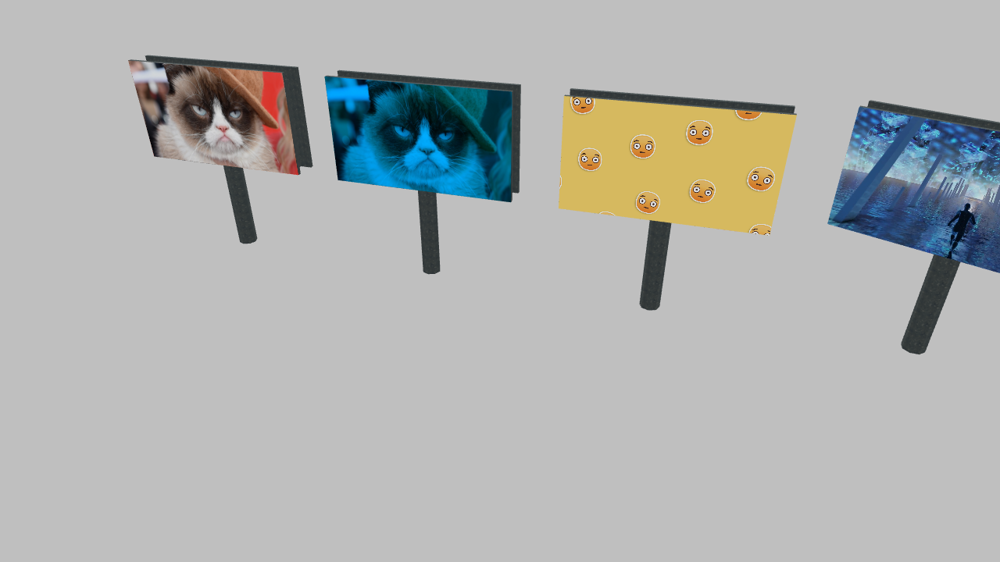
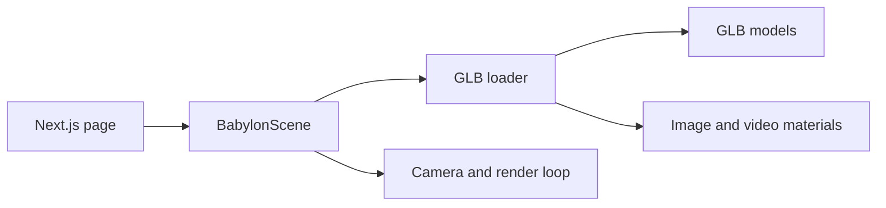

# Billboard Showcase

An interactive 3D proof of concept built with Next.js, TypeScript, and Babylon.js. It explores loading GLB billboards, applying image and video textures, and rotating models within a browser-rendered scene.

[Live demo](https://billboard-showcase.vercel.app/) · [Portfolio](https://www.grbulegoda.com)



Preview captured from the public demo. Camera position and animated textures change during interaction.

## What it demonstrates

- Four billboard model configurations: static imagery, blue emissive materials, video textures, and rotating video billboards.
- A shared GLB loader that finds named meshes and applies materials.
- Orbit-camera interaction, scene lighting, and a resize-aware canvas.
- Mesh inspection through browser-console logging.
- Engine disposal and resize-listener cleanup when the scene component unmounts.

This is a focused rendering experiment, not an advertising platform or production asset-management system.

## Explore the code



| File / directory | Responsibility |
| --- | --- |
| [src/app/page.tsx](src/app/page.tsx) | Page entry point |
| [src/components/BabylonScene.tsx](src/components/BabylonScene.tsx) | Camera, lighting, model configuration, animation, lifecycle |
| [src/utils/glbLoader.ts](src/utils/glbLoader.ts) | GLB import and named-mesh texture assignment |
| [public/3D assets](public/3D%20assets) | Billboard models |
| [public/images](public/images) / [public/videos](public/videos) | Texture sources |

## Run locally

Use Node.js 22 and npm, or Bun with the committed `bun.lock`. A WebGL-capable browser and hardware acceleration are needed to view the scene.

```sh
git clone https://github.com/gayanukabulegoda/Billboard-Showcase.git
cd Billboard-Showcase
npm install
npm run dev
```

Open `http://localhost:3000`. There are no required environment variables or backend services.

For installation using the committed dependency lockfile:

```sh
bun install --frozen-lockfile
bun run dev
```

Choose one package manager for your checkout. The repository tracks a Bun lockfile, not an npm lockfile.

## Controls

| Action | Result |
| --- | --- |
| Drag the canvas | Orbit the camera |
| Mouse wheel or trackpad scroll | Zoom |
| Select a mesh | Inspect the mesh information in the browser console |

Videos are configured to loop, play inline, and remain muted. Playback can still be blocked by browser/device policies. If a surface is blank, inspect the network and console for asset-loading or playback errors.

## Change the scene

Edit `glbConfigs` in [BabylonScene.tsx](src/components/BabylonScene.tsx). Each entry specifies a model and texture assignments:

```ts
{
  glbFile: "billboard.glb",
  textures: [{
    meshName: "Billboard_1920x1080_001_primitive2",
    texturePath: "/images/bad_meow_01.jpg",
    materialName: "customMaterial",
    isVideo: false,
  }],
}
```

The mesh name must match the imported GLB. If it does not, the loader logs the available mesh names. Use `isVideo: true` for video textures. Material names containing `glow` enable the existing blue emissive-material treatment; this is not a border-only glow shader.

## Checks and current limits

```sh
npm run lint
npm run build
npm start
```

`npm start` serves the output of a successful build. These scripts are defined in `package.json`; no automated interaction or performance test suite is supplied.

- Frame rate depends on device, asset size, and video decoding. There is no published 60 FPS benchmark or verified browser-version compatibility matrix.
- The current implementation imports a model for each texture assignment. Consolidating imports is a potential optimization.
- Rotation advances per rendered frame; it is not delta-time based.
- The loader appends hidden video elements, and the scene's cleanup does not explicitly remove those DOM elements or cancel the delayed rotation callback.
- There is no explicit LOD or asset-compression pipeline implemented in these source files.

These are useful next steps for developing the experiment further. The current README describes the implementation rather than claiming those improvements are complete.

## License and author

[MIT](LICENSE) · [Gayanuka Bulegoda](https://www.grbulegoda.com)
